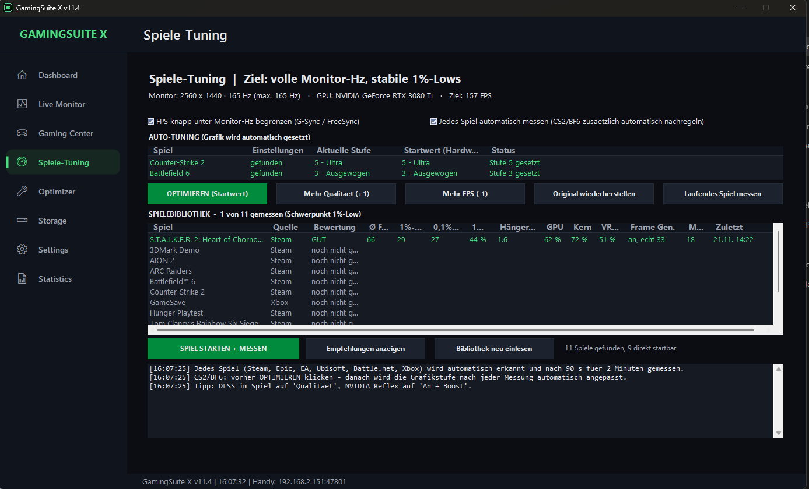
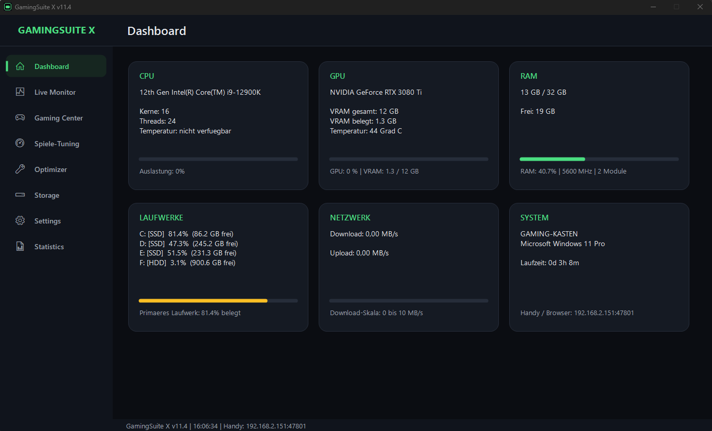

# GamingSuite X

Kostenloses Windows-Tool: misst, wie flüssig deine Spiele wirklich laufen (1%-Lows, Hänger), prüft die Hardware und erklärt die Ursachen verständlich. Mit Handy-/Web-App.

> 🇬🇧 *Free Windows gaming tool: hardware diagnostics, one-click tuning, automatic FPS / 1%-low measurement for every game, plus a phone/web dashboard. UI is currently German only.*

## Screenshots

| PC-Programm | Handy-App |
|---|---|
|  |  |

---

## Funktionen

| Bereich | Was es macht |
|---|---|
| **Dashboard & Live-Monitor** | CPU, GPU, RAM, Laufwerke, Netzwerk und Temperaturen live, mit Verlaufskurven |
| **Optimizer** | Hardware-Diagnose (BIOS-Alter, Treiber, XMP/EXPO, Resizable BAR, SSD …) und Gaming-Einstellungen zum Ankreuzen, **mit Backup und „Alles zurücksetzen“**. Windows-Dienste werden nie verändert; Einstellungen mit mehr Stromverbrauch sind nur optional |
| **Spiele-Tuning** | Erkennt automatisch jedes laufende Spiel (Steam, Epic, GOG, Ubisoft, EA, Battle.net, Riot, Xbox) und misst Ø FPS, **1%-Low, 0,1%-Low und Hänger pro Minute**. Gibt konkrete Empfehlungen (GPU-, CPU- oder VRAM-Limit, Frame Generation …) |
| **Auto-Tuning** | Counter-Strike 2 und Battlefield 6: Grafik wird automatisch auf deine Monitor-Hz eingestellt und nach jeder Messung nachgeregelt |
| **Spielebibliothek** | Alle installierten Spiele, per Knopf starten und messen |
| **Handy / Browser** | Android-App oder Web-App (iPhone, Tablet, jeder Browser) zeigt alle Werte im WLAN, **nur lesend** |
| **Fehlerbericht** | Ein Klick erzeugt eine ZIP-Datei für Issues, ohne PC-Name, Benutzername und Prozessliste |

## Voraussetzungen

- **Windows 10 (ab 1709) oder Windows 11**, mit Windows PowerShell 5.1 (bereits vorinstalliert)
- Administratorrechte, die nötig für den Optimizer sind. Das Programm fragt beim Start danach.
- Grafikkarte: **NVIDIA, AMD und Intel** werden unterstützt.
  - GPU-Auslastung und VRAM kommen bei allen Herstellern über Windows.
  - Die GPU-**Temperatur** wird bei NVIDIA direkt gelesen. Bei AMD/Intel und für die CPU-Temperatur braucht es zusätzlich [LibreHardwareMonitor](https://github.com/LibreHardwareMonitor/LibreHardwareMonitor), gestartet als Administrator.
- macOS und Linux werden **nicht** unterstützt, weil alle Optimierungen Windows-Einstellungen betreffen.

## Installation

1. Unter [Releases](../../releases) die neueste `GamingSuiteX-PC-vX.Y.zip` herunterladen.
2. Entpacken, z. B. nach `C:\GamingSuiteX`. Der Ordner `Modules` muss neben `GamingSuiteX.ps1` liegen.
3. `START_GamingSuiteX.bat` doppelklicken.
   - Fragt Windows nach Administratorrechten, mit **Ja** bestätigen.
   - Erscheint „Der Computer wurde durch Windows geschützt“: **Weitere Informationen**, dann **Trotzdem ausführen** (siehe [FAQ](#faq)).
   - Fragt die Firewall nach: **Private Netzwerke** zulassen. Das ist nur für den Handy-Zugriff nötig.
4. Beim ersten Start erscheint ein Hinweis, den du bestätigen musst.

## Handy-App / Web-App

- **iPhone, iPad, alle Browser:** Am PC unter **Settings** die Adresse ablesen, z. B. `http://192.168.178.20:47801`, und im Browser des Handys öffnen. Dann **Teilen** und **Zum Home-Bildschirm**.
- **Android:** Die `GamingSuiteX.apk` aus den Releases installieren. „Unbekannte Apps installieren“ muss dafür erlaubt sein.
- Handy und PC müssen im **selben WLAN** sein. Der Zugriff ist nur lesend, vom Handy aus lässt sich nichts ändern.
- Unter **Settings** lässt sich der Zugriff abschalten oder mit einer **PIN** schützen. Die PIN fragt derzeit nur die Web-App ab, die Android-App unterstützt sie noch nicht.

## Sicherheit & Datenschutz

- **Ohne Gewähr.** Der Optimizer ändert nur Einstellungen, die du bestätigst (Registry, auf Wunsch Energiesparplan und Netzwerk). Dienste wie Druckerwarteschlange oder Windows-Suche werden **nicht** angefasst. Energiesparplan „Höchstleistung“, CPU-Mindestleistung 100 % und Power Throttling sind nur optional, weil sie den Stromverbrauch auch im Leerlauf erhöhen (je nach PC ca. 10–50 W). Vor jeder Änderung wird ein Backup angelegt, und **„Alles zurücksetzen“** stellt den Originalzustand wieder her. Im Zweifel vorher einen Wiederherstellungspunkt anlegen.
- **„Alles optimieren“** ändert nur unkritische Einstellungen:
  - Die Mausbeschleunigung und die Netzwerk-Tweaks sind **optional** und werden nur einzeln per Haken gesetzt.
  - Die **Speicher-Integrität** (Kernisolierung) wird nie automatisch geändert. Sie hat einen eigenen Knopf mit Warnung, denn das Ausschalten senkt die Sicherheit von Windows.
  - Bei **AMD Ryzen X3D mit zwei CCDs** (z. B. 7950X3D) bleiben Energiesparplan, Core-Parking und Game Bar unangetastet, weil der 3D-Cache sie braucht.
- **Spiele-Einstellungen** (CS2, Battlefield 6) werden nur bei geschlossenem Spiel geändert, vorher wird gesichert. Es wird nichts in laufende Spiele eingeschleust, wichtig wegen Anti-Cheat.
- **Keine Telemetrie.** Es werden keine Daten ins Internet gesendet. Einzige Internetverbindung: der einmalige Download von Intel PresentMon von GitHub.
- Der Handy-Server lauscht nur im lokalen Netz (Port 47801 TCP, 47800 UDP). Die Firewall-Regeln gelten nur für **private** Netzwerke.

## FAQ

**Windows SmartScreen oder Virenscanner warnt?**
Das Programm ist nicht digital signiert, denn ein Zertifikat kostet Geld. PowerShell-Skripte, die Admin-Rechte nutzen, die Registry ändern und etwas herunterladen, lösen bei manchen Scannern Fehlalarme aus. Der komplette Quellcode liegt offen in diesem Repository und kann geprüft werden.

**Die FPS-Messung startet nicht oder bricht ab?**
Das Spiel muss mindestens etwa 3,5 Minuten im Vordergrund laufen (90 s Wartezeit plus 2 min Messung). Menüs und Alt+Tab werden automatisch herausgefiltert. Manche Anti-Cheat-Systeme können die Messung blockieren. Dann bitte einen Fehlerbericht erstellen.

**Warum steht bei Frame Generation „echt 33“?**
Mit Frame Generation sind die angezeigten FPS etwa doppelt so hoch wie die echt berechneten. Für die Eingabeverzögerung zählen die echten FPS, unter etwa 55 fühlt es sich träge an.

## Fehler melden

**Settings → Fehlerbericht erstellen** legt eine ZIP-Datei auf den Desktop. Bitte ein [Issue](../../issues/new/choose) eröffnen und die Datei anhängen.

## Projektaufbau

```
pc/        Windows-Programm (PowerShell 5.1 + WinForms)
  GamingSuiteX.ps1          Startskript
  START_GamingSuiteX.bat    Starter (holt Admin-Rechte)
  Modules/                  Module (Hardware, Optimizer, Spiele-Tuning, UI, Handy-Server ...)
  Modules/web/              Web-App für Handy/Browser
mobile/    Android-App (Flutter), Quellcode unter lib/
docs/      Anleitungen (Release, Android-Build)
```

## Lizenz

[MIT](LICENSE). Kostenlos nutzen, verändern und weitergeben. Verwendete Fremdsoftware siehe [THIRD_PARTY.md](THIRD_PARTY.md).
